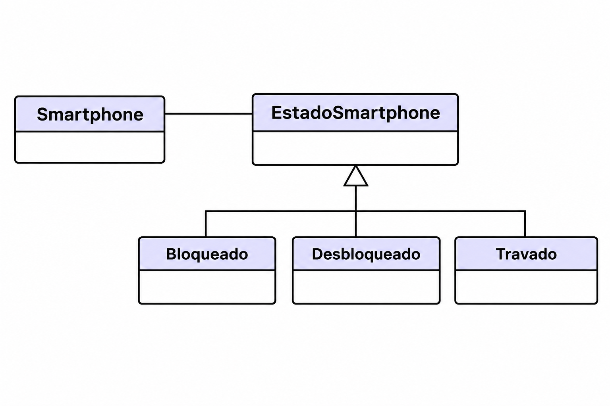

# Padrão de Projeto State — Smartphone

## Sobre a atividade

Esta atividade utiliza o padrão de projeto State para representar os diferentes estados de funcionamento de um smartphone. Cada estado possui comportamentos específicos e determina quais operações podem ser realizadas pelo aparelho.

## Estados implementados

- **Bloqueado:** permite inserir a senha para desbloquear o smartphone. Após três tentativas incorretas, o aparelho passa para o estado Travado.
- **Desbloqueado:** permite bloquear novamente o smartphone.
- **Travado:** impede novas operações durante cinco segundos. Após esse período, retorna automaticamente ao estado Bloqueado.

## Regras de funcionamento

1. O smartphone inicia no estado Bloqueado.
2. A senha correta permite o desbloqueio.
3. Senhas incorretas incrementam o contador de tentativas.
4. Na terceira tentativa incorreta, o smartphone fica Travado por cinco segundos.
5. Após o tempo de espera, retorna ao estado Bloqueado e o contador é zerado.
6. Um smartphone desbloqueado pode ser bloqueado novamente.

## Testes

Os testes verificam as transições entre os estados, a validação da senha, o limite de tentativas, as operações não permitidas e o retorno automático ao estado Bloqueado após cinco segundos.

## Diagrama de Classe
